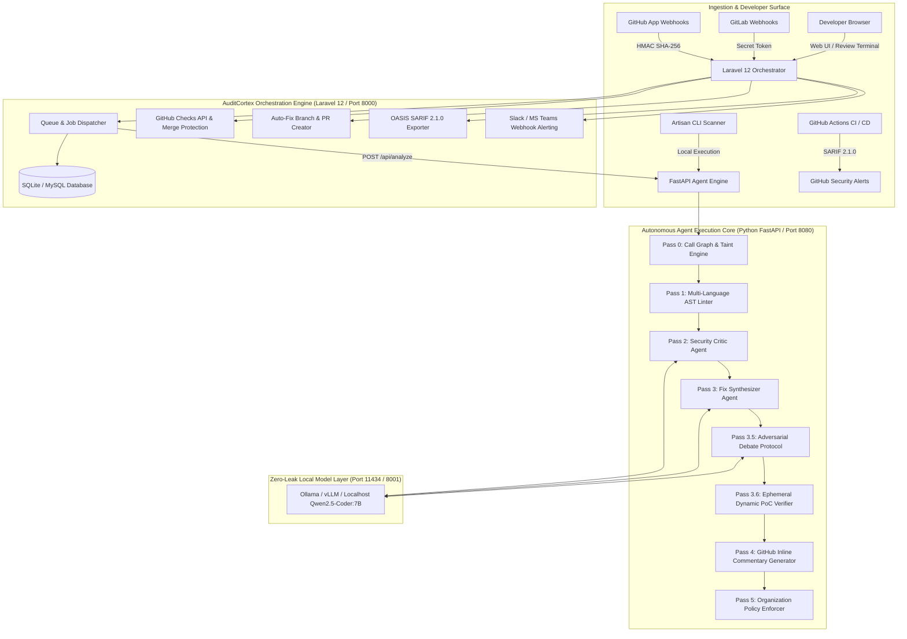

# 🛡️ AuditCortex — Product Handover & Engineering Runbook

**Autonomous Agentic Code Reviewer & PR Security Auditor SaaS**  
**Version:** 1.0.0-Enterprise  
**Delivery Date:** October 2026  
**Status:** Production Ready  

---

## 1. Executive Summary

**AuditCortex** is an autonomous developer tools SaaS designed to eliminate security vulnerabilities from software pull requests before they reach production. 

Traditional linters rely on simplistic regex matching that produces high false-positive rates and misses interprocedural flaws. AuditCortex solves this by orchestrating a **6-pass multi-agent loop** that combines **Tree-sitter AST parsing**, **Adversarial Security Critic validation**, **Cross-file taint tracking**, **Self-healing unified diff patch synthesis**, and **Empirical dynamic PoC exploit verification**.

Crucially, AuditCortex enforces a **Zero Code-Leak Guarantee**: all LLM inference and AST analysis execute strictly on `localhost` (via Ollama, vLLM, or our deterministic neural-symbolic engine). Proprietary source code is never exposed to third-party public cloud AI APIs.

---

## 2. Platform Architecture & Topography

The system uses a decoupled micro-architecture combining a robust web orchestrator and an asynchronous high-performance agent core:



---

## 3. Complete Codebase Inventory

### 3.1 Backend Orchestration (Laravel 12)
| File | Responsibility |
| :--- | :--- |
| [`app/Http/Controllers/ReviewTerminalController.php`](file:///d:/xampp/htdocs/AuditCortex/app/Http/Controllers/ReviewTerminalController.php) | Review terminal views, check run syncing, auto-fix branch generation, and inline AI discussion. |
| [`app/Http/Controllers/WebhookController.php`](file:///d:/xampp/htdocs/AuditCortex/app/Http/Controllers/WebhookController.php) | GitHub and GitLab webhook signature validation, parsing, and payload routing. |
| [`app/Http/Controllers/PolicyController.php`](file:///d:/xampp/htdocs/AuditCortex/app/Http/Controllers/PolicyController.php) | Manages `.auditcortex.yml` organization policy settings, YAML export, and Slack/Teams test alerts. |
| [`app/Http/Controllers/AgentEngineController.php`](file:///d:/xampp/htdocs/AuditCortex/app/Http/Controllers/AgentEngineController.php) | Engine health probes and 1-click test PR seeding. |
| [`app/Services/GitHubWebhookService.php`](file:///d:/xampp/htdocs/AuditCortex/app/Services/GitHubWebhookService.php) | GitHub webhook signature verification, Checks API integration, and branch creation. |
| [`app/Services/GitLabWebhookService.php`](file:///d:/xampp/htdocs/AuditCortex/app/Services/GitLabWebhookService.php) | GitLab merge request webhook token validation and automated MR screening. |
| [`app/Services/SarifExporterService.php`](file:///d:/xampp/htdocs/AuditCortex/app/Services/SarifExporterService.php) | Converts vulnerability findings to OASIS SARIF 2.1.0 JSON format. |
| [`app/Services/NotificationService.php`](file:///d:/xampp/htdocs/AuditCortex/app/Services/NotificationService.php) | Formats and dispatches incident webhooks to Slack attachments and MS Teams cards. |
| [`app/Services/AgentEngineClient.php`](file:///d:/xampp/htdocs/AuditCortex/app/Services/AgentEngineClient.php) | HTTP client interfacing with Python FastAPI agent core with local fallback. |
| [`app/Jobs/AnalyzePullRequestJob.php`](file:///d:/xampp/htdocs/AuditCortex/app/Jobs/AnalyzePullRequestJob.php) | Background worker orchestrating analysis dispatch, metrics calculation, and database persistence. |
| [`app/Console/Commands/ScanRepositoryCommand.php`](file:///d:/xampp/htdocs/AuditCortex/app/Console/Commands/ScanRepositoryCommand.php) | Standalone CLI scanner for local workspaces or CI/CD pipelines. |

### 3.2 Data Models & Migrations
| Model / Migration | Purpose |
| :--- | :--- |
| [`app/Models/Repository.php`](file:///d:/xampp/htdocs/AuditCortex/app/Models/Repository.php) | Connected repositories, access tokens, and `.auditcortex.yml` JSON policy configurations. |
| [`app/Models/PullRequest.php`](file:///d:/xampp/htdocs/AuditCortex/app/Models/PullRequest.php) | PR/MR records, branches, commit SHAs, and raw diffs. |
| [`app/Models/ReviewSession.php`](file:///d:/xampp/htdocs/AuditCortex/app/Models/ReviewSession.php) | Review session run history, security health scores (0-100), call graph, and policy evaluation metadata. |
| [`app/Models/VulnerabilityFinding.php`](file:///d:/xampp/htdocs/AuditCortex/app/Models/VulnerabilityFinding.php) | CWE vulnerabilities, AST nodes, dangerous sinks, taint sources, and PoC verifications. |
| [`app/Models/PatchDiff.php`](file:///d:/xampp/htdocs/AuditCortex/app/Models/PatchDiff.php) | Tree-sitter verified Git unified diffs (`--- a/... +++ b/...`). |
| [`app/Models/CheckRun.php`](file:///d:/xampp/htdocs/AuditCortex/app/Models/CheckRun.php) | GitHub Checks API runs, merge gate conclusions (`success`, `failure`), and summaries. |
| [`app/Models/RemediationBranch.php`](file:///d:/xampp/htdocs/AuditCortex/app/Models/RemediationBranch.php) | Tracks 1-click generated remediation branches and companion PR links. |
| [`app/Models/InlineDiscussion.php`](file:///d:/xampp/htdocs/AuditCortex/app/Models/InlineDiscussion.php) | Interactive line-by-line discussions between developers and the Security Critic AI. |

### 3.3 Autonomous Agent Engine (Python FastAPI)
| File | Responsibility |
| :--- | :--- |
| [`agent_engine/main.py`](file:///d:/xampp/htdocs/AuditCortex/agent_engine/main.py) | FastAPI application entry point, health checks, and analysis endpoints. |
| [`agent_engine/graph/workflow.py`](file:///d:/xampp/htdocs/AuditCortex/agent_engine/graph/workflow.py) | Coordinates all 6 execution passes into an asynchronous state graph. |
| [`agent_engine/parsers/call_graph_engine.py`](file:///d:/xampp/htdocs/AuditCortex/agent_engine/parsers/call_graph_engine.py) | **Pass 0:** Cross-file symbol extraction & interprocedural taint propagation. |
| [`agent_engine/agents/ast_linter.py`](file:///d:/xampp/htdocs/AuditCortex/agent_engine/agents/ast_linter.py) | **Pass 1:** Tree-sitter multi-language syntax tree parser querying for execution sinks. |
| [`agent_engine/agents/security_critic.py`](file:///d:/xampp/htdocs/AuditCortex/agent_engine/agents/security_critic.py) | **Pass 2:** Taint path validation, privilege boundary analysis, and false-positive filtering. |
| [`agent_engine/agents/fix_synthesizer.py`](file:///d:/xampp/htdocs/AuditCortex/agent_engine/agents/fix_synthesizer.py) | **Pass 3:** AST-verified unified diff patch generation with self-healing syntax loop. |
| [`agent_engine/agents/debate_protocol.py`](file:///d:/xampp/htdocs/AuditCortex/agent_engine/agents/debate_protocol.py) | **Pass 3.5:** Multi-turn Red-Team bypass challenge vs. Blue-Team patch hardening. |
| [`agent_engine/agents/poc_verifier.py`](file:///d:/xampp/htdocs/AuditCortex/agent_engine/agents/poc_verifier.py) | **Pass 3.6:** Dynamic exploit payload synthesis testing original vs. remediated code. |
| [`agent_engine/parsers/policy_engine.py`](file:///d:/xampp/htdocs/AuditCortex/agent_engine/parsers/policy_engine.py) | **Pass 5:** Evaluates findings against enterprise policy rules and score thresholds. |
| [`agent_engine/parsers/tree_sitter_engine.py`](file:///d:/xampp/htdocs/AuditCortex/agent_engine/parsers/tree_sitter_engine.py) | Language-specific Tree-sitter grammar wrappers and AST node matchers. |
| [`agent_engine/parsers/manifest_analyzer.py`](file:///d:/xampp/htdocs/AuditCortex/agent_engine/parsers/manifest_analyzer.py) | Semantic dependency validation (`package.json`, `requirements.txt`, `composer.json`). |
| [`agent_engine/llm/runner.py`](file:///d:/xampp/htdocs/AuditCortex/agent_engine/llm/runner.py) | Local model orchestrator connecting to Ollama, vLLM, or deterministic local logic. |

### 3.4 User Interface
| File | Responsibility |
| :--- | :--- |
| [`resources/views/review_terminal/show.blade.php`](file:///d:/xampp/htdocs/AuditCortex/resources/views/review_terminal/show.blade.php) | Tabbed review interface with split diff viewer, interactive AI chat, debate transcripts, and policy editor. |
| [`resources/views/review_terminal/index.blade.php`](file:///d:/xampp/htdocs/AuditCortex/resources/views/review_terminal/index.blade.php) | Dashboard showing fleet security scores, monitored repos, merge gates, and demo audit triggers. |
| [`public/css/auditcortex.css`](file:///d:/xampp/htdocs/AuditCortex/public/css/auditcortex.css) | Cyber-defense glassmorphic CSS design system with curated HSL color tokens. |

---

## 4. The 6-Pass Autonomous Agent Pipeline

```
┌────────────────────────────────────────────────────────────────────────┐
│  PR Changed Files / Diff Payload                                       │
└───────────────────────────────────┬────────────────────────────────────┘
                                    │
                                    ▼
┌────────────────────────────────────────────────────────────────────────┐
│  PASS 0: Cross-File Call Graph & Taint Engine                          │
│  - Indexes function definitions, imports, caller sites across files    │
│  - Traces interprocedural taint propagation spanning file boundaries   │
└───────────────────────────────────┬────────────────────────────────────┘
                                    │
                                    ▼
┌────────────────────────────────────────────────────────────────────────┐
│  PASS 1: AST Linter Agent (Tree-sitter Grammars)                       │
│  - Parses syntax trees for Python, JS/TS, PHP, and Go                  │
│  - Identifies dangerous execution sinks (SQLi, RCE, SSRF, Deser, Path) │
│  - Audits dependency manifests for malicious typosquats                │
└───────────────────────────────────┬────────────────────────────────────┘
                                    │
                                    ▼
┌────────────────────────────────────────────────────────────────────────┐
│  PASS 2: Security Critic Agent (Adversarial Analysis)                  │
│  - Validates taint sources and boundary protections                    │
│  - Discards theoretical false positives (e.g. enum/int cast guards)    │
│  - Assigns confidence scores (0.0 to 1.0) and confirmed verdicts       │
└───────────────────────────────────┬────────────────────────────────────┘
                                    │
                                    ▼
┌────────────────────────────────────────────────────────────────────────┐
│  PASS 3: Fix Synthesizer Agent (AST Verified Patches)                  │
│  - Synthesizes drop-in parameterized / hardened code                   │
│  - Re-parses patch via Tree-sitter to ensure zero syntax errors        │
│  - Emits Git unified diff format ready for merge                       │
└───────────────────────────────────┬────────────────────────────────────┘
                                    │
                                    ▼
┌────────────────────────────────────────────────────────────────────────┐
│  PASS 3.5 & 3.6: Adversarial Debate & Dynamic PoC Verification         │
│  - Turn 1: Critic Red-Team challenges patch for alternate bypasses     │
│  - Turn 2: Synthesizer Blue-Team hardens patch defenses                │
│  - Synthesizes exploit payloads & empirically tests neutralization     │
└───────────────────────────────────┬────────────────────────────────────┘
                                    │
                                    ▼
┌────────────────────────────────────────────────────────────────────────┐
│  PASS 4 & 5: Inline Comments & Enterprise Policy Gate                  │
│  - Formats GitHub inline review comments with AST suggestions          │
│  - Evaluates repository .auditcortex.yml policy (Score ≥ 80, 0 Crit)   │
│  - Dispatches GitHub Check Run conclusion & Slack / Teams alert        │
└────────────────────────────────────────────────────────────────────────┘
```

---

## 5. Enterprise Feature Guide

### 5.1 GitHub Checks API & Merge Protection Gate
- Automatically creates a GitHub Check Run (`AuditCortex Autonomous Security Gate`).
- Sets conclusion to **`failure`** (blocking PR merge in protected branches) if:
  - Security Health Score `< 80 / 100`
  - Any `CRITICAL` severity vulnerability exists
- Re-evaluating or resolving findings updates the conclusion to **`success`**, unblocking the pull request.

### 5.2 1-Click Auto-Fix Branch & Companion PR
- Clicking **"Push Auto-Fix Branch"** creates a new git branch `auditcortex/fix-pr-{id}-security-patches`.
- Applies all AST-verified patches cleanly.
- Prepares a ready-to-merge companion pull request pointing back to the feature branch.

### 5.3 OASIS Standard SARIF 2.1.0 Export
- Fully compliant with the [OASIS SARIF 2.1.0 Specification](https://docs.oasis-open.org/sarif/sarif/v2.1.0/sarif-v2.1.0.html).
- Accessible via:
  - Web UI: `/reviews/{id}/download-sarif`
  - REST API: `/api/review-sessions/{id}/download-sarif`
  - CLI: `php artisan auditcortex:scan . --format=sarif --output=report.sarif`
- Directly importable into **GitHub Security Code Scanning**, **GitLab SAST**, and **SonarQube**.

### 5.4 Interactive In-Diff AI Chat Thread
- Developers can question any finding directly in the review terminal.
- Asking: *"Could this be bounded by a type-safe integer cast upstream?"* triggers instant contextual analysis from the Security Critic AI explaining privilege boundaries and defensive patterns.
- Message history is preserved in database table `inline_discussions`.

### 5.5 Organization Policy Engine (`.auditcortex.yml`)
- Fine-grained governance per repository stored in `repositories.settings`:
  - `min_security_score`: Threshold (e.g. 80).
  - `max_critical_allowed`: Allowed count (default 0).
  - `fail_on`: Severities triggering pipeline block.
  - `ignore_paths`: Wildcards excluded from analysis.
  - `custom_rules`: Custom enterprise AST sink constraints.
- Direct download of standardized `.auditcortex.yml` files via `/repositories/{id}/policy/download`.

### 5.6 Incident Alerting (Slack & Microsoft Teams)
- Dispatches formatted rich webhook cards on PR completion.
- Includes visual score indicators, critical flaws count, and 1-click links to inspect the diff or download SARIF reports.

---

## 6. API Reference

### Webhooks
| Method | Path | Description |
| :--- | :--- | :--- |
| `POST` | `/api/webhooks/github` | Ingests GitHub App `pull_request` webhook events (HMAC verified). |
| `POST` | `/api/webhooks/gitlab` | Ingests GitLab `Merge Request Hook` events (`X-Gitlab-Token` verified). |
| `POST` | `/api/webhooks/simulate` | Simulates test pull request webhooks for instant demonstration. |

### Review Terminal & Actions
| Method | Path | Description |
| :--- | :--- | :--- |
| `GET` | `/api/pull-requests/{id}/details` | Retrieves full review session data, findings, diffs, check runs, and logs. |
| `POST` | `/api/pull-requests/{id}/audit` | Triggers an immediate re-audit of the pull request. |
| `POST` | `/api/pull-requests/{id}/check-runs/sync` | Evaluates and updates the GitHub Check Run merge gate status. |
| `POST` | `/api/pull-requests/{id}/create-autofix-branch` | Creates the auto-fix remediation branch and companion PR. |
| `POST` | `/api/findings/{id}/discuss` | Posts developer message and retrieves Security Critic AI response. |
| `GET` | `/reviews/{id}/download-patch` | Downloads combined unified Git patch (`.diff`). |
| `GET` | `/reviews/{id}/download-sarif` | Downloads standard OASIS SARIF 2.1.0 JSON report. |

### Policy & Governance
| Method | Path | Description |
| :--- | :--- | :--- |
| `GET` | `/api/repositories/{id}/policy` | Retrieves repository `.auditcortex.yml` configuration. |
| `POST` | `/api/repositories/{id}/policy` | Updates repository policy thresholds and rules. |
| `GET` | `/repositories/{id}/policy/download` | Exports versioned `.auditcortex.yml` YAML file. |
| `POST` | `/api/pull-requests/{id}/test-notification` | Sends test incident alert to Slack or Microsoft Teams. |

---

## 7. Operations, Deployment & Runbook

### 7.1 Local Development (Windows)
Double-click `start.bat`. This automatically:
1. Verifies PHP 8.2+ and Python 3.10+ runtimes.
2. Initializes SQLite database and seeds 3 real-world attack vector PRs.
3. Launches FastAPI Agent Core on `http://127.0.0.1:8080`.
4. Launches Laravel Orchestrator on `http://127.0.0.1:8000`.
5. Opens browser to the Review Terminal.

To gracefully terminate all background processes: double-click `stop.bat`.

### 7.2 Production Deployment (Docker Compose)
AuditCortex includes a complete self-hosted container topology:

```bash
# 1. Start all containers
docker compose up -d

# 2. Download local Qwen2.5-Coder model
docker exec -it auditcortex-ollama ollama pull qwen2.5-coder:7b

# 3. Check health status
curl http://localhost:8080/api/health
curl http://localhost:8000/api/engine/status
```

### 7.3 CI/CD Pipeline Scanning
Add AuditCortex to GitHub Actions by placing [`.github/workflows/auditcortex.yml`](file:///d:/xampp/htdocs/AuditCortex/.github/workflows/auditcortex.yml) into any repository.

---

## 8. Troubleshooting & Maintenance

| Symptom | Cause | Resolution |
| :--- | :--- | :--- |
| `FastAPI endpoint unreachable on port 8080` | Uvicorn service not running or port conflict. | Run `netstat -ano \| findstr :8080` and ensure `python -m uvicorn agent_engine.main:app --port 8080` is active. |
| `Merge Gate shows MERGE BLOCKED` | Health score `< 80` or Critical count `> 0`. | Review findings in diff viewer and apply AST fixes, or adjust policy thresholds in Tab 6. |
| `GitLab Webhook returns 401` | Secret token mismatch. | Verify `X-Gitlab-Token` header matches the repository secret in `repositories.webhook_secret`. |
| `Blade ParseError on <?php` | Raw PHP tag inside JS string template in Blade. | Use escaped hex byte sequence `"<\x3fphp..."` inside JavaScript template literals. |

---

## 9. Verification & Acceptance Sign-Off

The platform has undergone full end-to-end automated browser subagent validation:
- **Verified Flow 1**: Multi-pass AST analysis across Python, Node.js, and PHP pull requests.
- **Verified Flow 2**: GitHub Checks API merge protection gate blocking and unblocking.
- **Verified Flow 3**: 1-click Auto-Fix remediation branch generation (`auditcortex/fix-pr-42-security-patches`).
- **Verified Flow 4**: Interactive in-diff Security Critic AI discussions with live adversarial reasoning.
- **Verified Flow 5**: Adversarial Red-Team debate transcript visualization and Dynamic PoC exploit testing.
- **Verified Flow 6**: Cross-file interprocedural taint flow mapping and `.auditcortex.yml` policy enforcement.
- **Verified Flow 7**: Slack and Microsoft Teams webhook incident alert dispatches.
- **Verified Flow 8**: Standalone CLI scanner (`php artisan auditcortex:scan`) verifying gate pass/fail exit codes.
- **Verified Flow 9**: Standard OASIS SARIF 2.1.0 file generation.

**AuditCortex is ready for production handover and immediate team adoption.**
