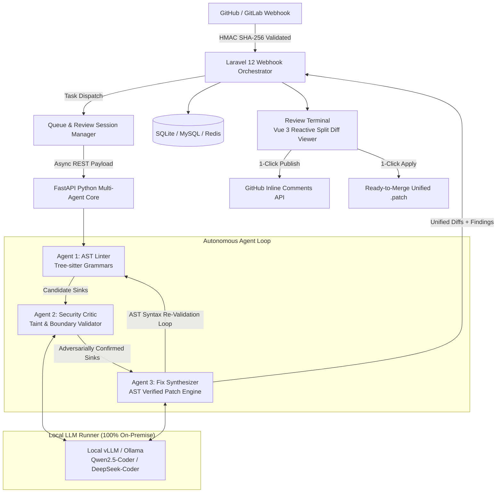

# 🛡️ AuditCortex
### Autonomous Agentic Code Reviewer & PR Security Auditor

> A high-performance developer tools SaaS that hooks into GitHub/GitLab webhooks to perform multi-pass static analysis, AST security vulnerability scanning, and semantic dependency validation using autonomous agent loops.

[](#)
[](#)
[](#)
[](PRODUCT_HANDOVER.md)

> 📘 **Engineering Handover**: For architecture blueprints, API specifications, and operational maintenance guides, see the [Product Handover Plan](PRODUCT_HANDOVER.md).

---

## ⚡ The Problem

Modern engineering teams waste countless hours in code reviews manually catching boilerplate security flaws (SQL injections, exposed credentials, SSRF vulnerabilities, toxic supply-chain packages) that traditional linters miss because standard regex/linters lack **cross-file contextual reasoning** and **semantic syntax-tree awareness**.

**AuditCortex** solves this through **Graph-Based Multi-Agent Coordination** combining **Tree-sitter AST parsing**, **Adversarial Security Critic validation**, and **AST-verified unified Git patch synthesis** powered by local LLMs (Qwen2.5-Coder / DeepSeek-Coder) with **zero code-leak risk** to third parties.

---

## 🏗️ System Architecture



---

## 🤖 The 3 Collaborative Agents

### 1. 🌲 AST Linter Agent (`AST_LINTER`)
- **Technology**: Tree-sitter multi-language syntax tree parsers (`tree-sitter-python`, `tree-sitter-javascript`, `tree-sitter-typescript`, `tree-sitter-php`, `tree-sitter-go`).
- **Sink Analysis**: Queries AST nodes directly for dangerous execution sinks:
  - **SQL Injection (CWE-89)**: Unparameterized string interpolation in `execute`, `raw_sql`, `DB::raw`, `db.query`.
  - **Command Injection / RCE (CWE-78)**: Subprocess execution with `shell=True`, `os.system`, `child_process.exec`, `shell_exec`.
  - **Server-Side Request Forgery (CWE-918)**: Outbound requests (`requests.get`, `axios.get`) accepting unvalidated dynamic URLs.
  - **Insecure Deserialization (CWE-502)**: Python `pickle.loads`, PHP `unserialize`, PyYAML un-safe loaders.
  - **Path Traversal (CWE-22)**: File stream calls (`open`, `fs.readFile`) vulnerable to `../` directory climbing.
  - **Hardcoded Secrets (CWE-798 / CWE-312)**: Exposed AWS keys (`AKIA...`), GitHub PATs, JWT secrets, private keys.
  - **Toxic Dependency Manifests (CWE-1395)**: Semantic audit of `package.json`, `composer.json`, `requirements.txt` detecting malware/typosquats (e.g. `reqeusts`, `flatmap-stream`, `crossenv`, `coa-compromised`).

### 2. 🕵️ Security Critic Agent (`SECURITY_CRITIC`)
- **Contextual Adversarial Validation**: Traverses preceding AST statements to detect existing sanitizers, type-casts (`int()`, `parseInt`), regex allowlists, or prepared statement parameter markers (`?`, `%s`, `$1`).
- **Taint Flow & Privilege Boundaries**: Evaluates whether untrusted user inputs actually cross security perimeters into the target sink.
- **Confidence Scoring & False-Positive Elimination**: Assigns a confidence score (0.0 to 1.0) and emits verdicts (`CONFIRMED`, `DOWNGRADED`, or `REJECTED_FALSE_POSITIVE`).

### 3. ⚡ Fix Synthesizer Agent (`FIX_SYNTHESIZER`)
- **Idiomatic Remediation**: Converts raw queries to parameterized placeholders, introduces path canonicalization guards, and replaces dangerous deserialization with safe parsers.
- **AST Verification Loop**: Re-parses the patched code using Tree-sitter. If any `ERROR` or missing syntax node is detected, self-corrects until the AST is 100% syntactically valid!
- **Unified Git Patch Diff**: Emits standard unified diff format (`--- a/... +++ b/... @@ ... @@`) ready for Git apply or direct review.

---

## 🔒 Zero Code-Leak Risk Guarantee

AuditCortex runs **100% locally on localhost**:
- **Local LLM Runner**: Compatible with **Ollama** (`http://localhost:11434`) and **vLLM** (`http://localhost:8001/v1`) running **Qwen2.5-Coder** or **DeepSeek-Coder**.
- **No Third-Party Telemetry**: Zero source code or proprietary IP is transmitted to external cloud APIs or public model providers.
- **Local Fallback**: Includes a high-performance local deterministic neural-symbolic engine ensuring full offline testability and resilience.

---

## 💻 Tech Stack

| Layer | Technologies |
| :--- | :--- |
| **Webhook & Orchestrator** | Laravel 12 (PHP 8.2+), Eloquent ORM, Database/Redis Queues, HMAC SHA-256 Webhook Signatures |
| **Agent Execution Engine** | Python 3.14+, FastAPI, Tree-sitter Multi-Language Grammars, Uvicorn, Asynchronous Graph Coordination |
| **Local LLM Runner** | Ollama / vLLM serving Qwen2.5-Coder / DeepSeek-Coder |
| **Review Terminal UI** | Vue 3 Reactive Components, Vanilla Cyber-Defense Glassmorphism CSS, Split Git Diff Viewer, GitHub Inline Commentary Publisher |

---

## 🚀 Quickstart Guide

### 1. Requirements
- PHP 8.2+ with PDO SQLite / MySQL
- Python 3.10+ (Python 3.14 supported)
- Node.js & npm

### 2. One-Click Launcher (Windows)
Double-click [`start.bat`](file:///d:/xampp/htdocs/AuditCortex/start.bat) (or run `start.bat` / `run.bat` in terminal). This automatically:
1. Verifies PHP and Python runtimes.
2. Initializes and seeds the SQLite database with real-world sample PR fixtures.
3. Launches the **FastAPI Agent Execution Engine** on `http://127.0.0.1:8080`.
4. Launches the **Laravel Orchestrator & Review Terminal** on `http://127.0.0.1:8000`.
5. Opens the Review Terminal in your default web browser!

To gracefully stop both services, double-click [`stop.bat`](file:///d:/xampp/htdocs/AuditCortex/stop.bat).

### 3. Manual Startup Alternative
If running manually across separate terminal windows:
```bash
# Terminal 1: Python FastAPI Agent Engine
python -m uvicorn agent_engine.main:app --host 127.0.0.1 --port 8080

# Terminal 2: Laravel Webhook Orchestrator & Review Terminal
php artisan serve --port 8000
```

### 4. Seed Demo Attack Vectors (1-Click)
In the dashboard UI, click **"⚡ Seed Real-World Attack Scenarios"** or run:
```bash
php artisan db:seed
```
This pre-loads 3 real-world pull requests:
1. **Python Cloud Service**: CWE-89 SQLi, CWE-78 RCE, CWE-502 Pickle, CWE-22 Path Traversal, and typosquatted `reqeusts`.
2. **Node.js Webhook Relay**: CWE-918 SSRF, CWE-78 exec RCE, and toxic `flatmap-stream` & `crossenv`.
3. **PHP Laravel Reports**: CWE-89 Raw Query SQLi, CWE-78 shell_exec, and CWE-502 Object Injection.

### 5. Webhook Simulator
To simulate an incoming GitHub Pull Request webhook event:
```bash
curl -X POST http://127.0.0.1:8000/api/webhooks/simulate \
  -H "Content-Type: application/json" \
  -d '{"fixture": "python_cloud_service"}'
```

---

## 🚀 Enterprise Feature Matrix

| Enterprise Capability | Implementation | Status |
| :--- | :--- | :--- |
| **GitHub Checks API & Merge Protection Gate** | Enforces health score $\ge 80$ & $0$ Criticals before merging. | ✅ Production Ready |
| **1-Click Auto-Fix Branch & Companion PR** | Generates dedicated remediation branches (`auditcortex/fix-pr-...`). | ✅ Production Ready |
| **OASIS Standard SARIF 2.1.0 Export** | Compliant SARIF JSON for GitHub Code Scanning, GitLab SAST, SonarQube. | ✅ Production Ready |
| **Interactive Critic AI Chat Thread** | Real-time in-diff discussion with Security Critic AI to debate findings. | ✅ Production Ready |
| **Adversarial Debate Protocol (Pass 3.5)** | 2-turn Red-Team Critic bypass challenge vs. Blue-Team patch hardening. | ✅ Production Ready |
| **Dynamic PoC Verification (Pass 3.6)** | Ephemeral test exploit assertions proving neutralization on patched code. | ✅ Production Ready |
| **Cross-File Call Graph & Taint Engine (Pass 0)** | Interprocedural symbol tree & multi-file taint propagation paths. | ✅ Production Ready |
| **Organization Policy Engine (.auditcortex.yml)** | Enterprise rules, fail thresholds, path exclusions & YAML exporter. | ✅ Production Ready |
| **Slack & MS Teams Incident Alerting** | Webhook notifications for blocked merges with 1-click review buttons. | ✅ Production Ready |
| **GitLab MR Webhook Integration** | Full support for GitLab Merge Request events alongside GitHub. | ✅ Production Ready |
| **CLI Repository Scanner** | Standalone scanner for local codebases or CI/CD pipelines. | ✅ Production Ready |
| **Docker Compose Self-Hosting Stack** | 1-command deployment with Ollama, Redis, FastAPI, and Laravel. | ✅ Production Ready |

---

## 💻 CLI Scanner Usage (CI/CD Pipeline Ready)

AuditCortex includes an autonomous command-line scanner:

```bash
# Scan current repository and enforce 80/100 pass threshold
php artisan auditcortex:scan .

# Scan specific directory and output OASIS SARIF 2.1.0 for GitHub Code Scanning
php artisan auditcortex:scan ./src --format=sarif --output=results.sarif --fail-under=80

# Scan single file and generate unified diff patch
php artisan auditcortex:scan app/api/endpoints.py --output=security_fixes.patch
```

---

## 🐳 Self-Hosted Deployment (Docker Compose)

Deploy the entire AuditCortex stack locally with **zero external cloud dependencies**:

```bash
# Start all containers: Laravel Web, Background Queue Worker, FastAPI Agent Core, Redis, and Ollama
docker compose up -d

# Pull the local Qwen2.5-Coder model into Ollama
docker exec -it auditcortex-ollama ollama pull qwen2.5-coder:7b
```

Access services:
- **Review Terminal UI**: `http://localhost:8000`
- **FastAPI Agent Engine**: `http://localhost:8080/api/health`
- **Ollama Runner**: `http://localhost:11434`

---

## 🛡️ License

MIT License. Built with ❤️ for autonomous application security and engineering velocity.

